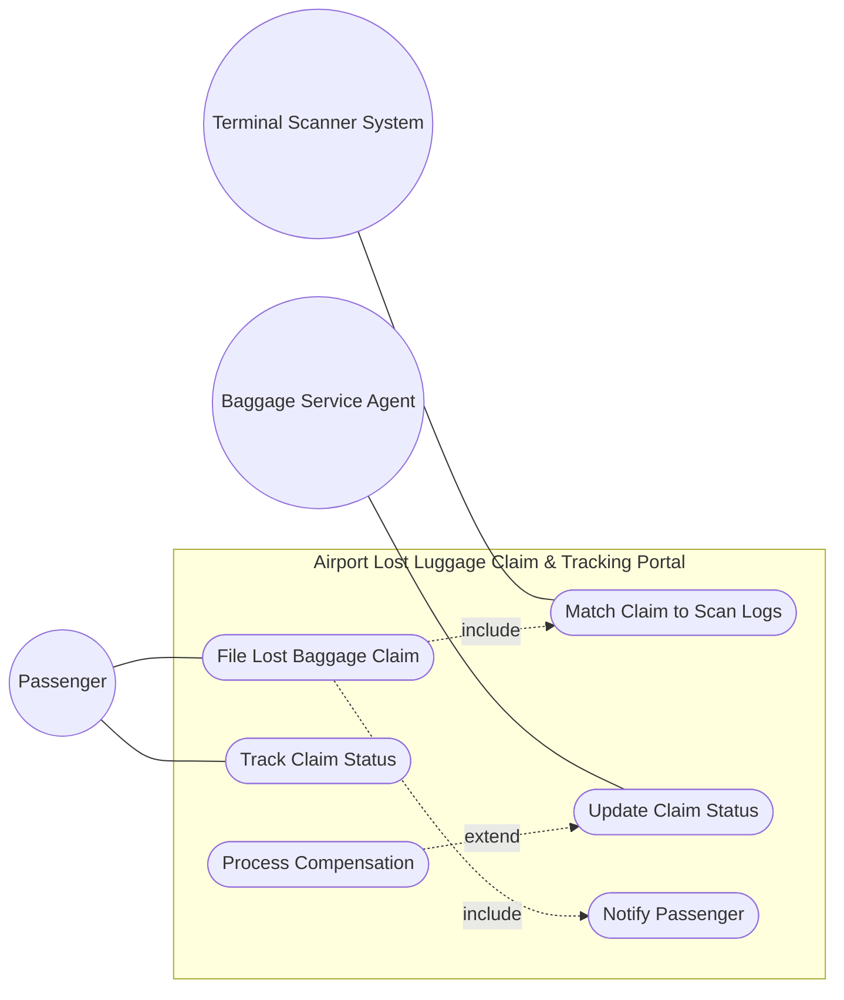
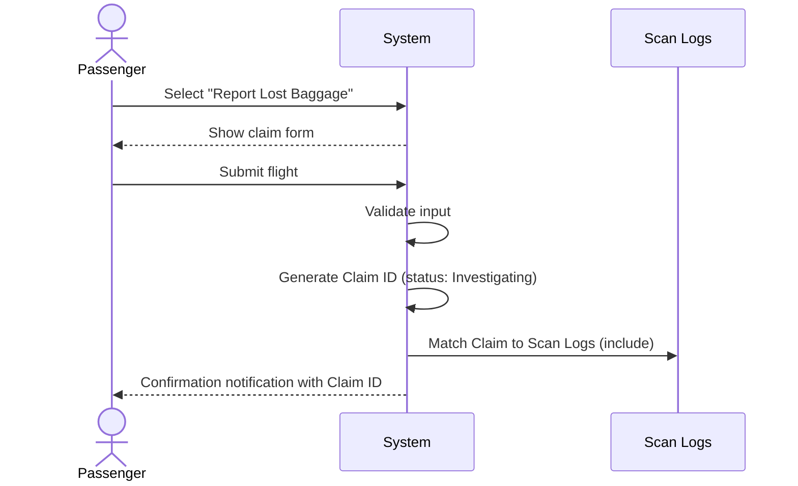

# ✈️ SE-RE-UML-Project

### Software Engineering — Requirements Engineering & UML

**Airport Lost Luggage Claim & Tracking Portal**

---

## 🗺️ System at a Glance

## 🔁 Main Flow — File Lost Baggage Claim

## 👤 Actors

| Actor | Role |
|---|---|
| 🧳 **Passenger** | Files and tracks baggage claims |
| 🛎️ **Baggage Service Agent** | Updates claim status, processes compensation |
| 📡 **Terminal Scanner System** | Feeds scan logs used for automatic matching |

## 📋 Requirements Snapshot

| ID | Priority | Requirement |
|---|:---:|---|
| `FR-1` | 🔴 High | Cross-reference lost baggage reports against terminal scan logs |
| `FR-2` | 🔴 High | Allow passengers to submit a lost baggage report |
| `FR-3` | 🔴 High | Allow agents to update claim status with timestamp + agent ID |
| `FR-4` | 🟡 Medium | Auto-notify passengers whenever claim status changes |

*Full table with acceptance criteria and rationale → [`Requirements_Table.xlsx`](Requirements_Table.xlsx)*

## 📁 Contents

| File | Type | Description |
|---|---|---|
| [`Airport_baggage_use_caase.drawio`](Airport_baggage_use_caase.drawio) | 🗺️ UML Use Case Diagram | Actors and use cases with `include`/`extend` relationships. Open in [draw.io](https://app.diagrams.net/). |
| [`Requirements_Table.xlsx`](Requirements_Table.xlsx) | 📋 Requirements Table | Functional requirements with priority, acceptance criteria, and rationale. |
| [`UseCase_Flow_FileLostBaggageClaim.docx`](UseCase_Flow_FileLostBaggageClaim.docx) | 📝 Use-Case Flow Spec | Main success scenario and alternate flow for "File Lost Baggage Claim". |
| [`30_SE_Lab1_SE_Problem_Statements.pdf`](30_SE_Lab1_SE_Problem_Statements.pdf) | 📄 Problem Statement | Original Lab 1 assignment brief. |

---

*Lab 1 Deliverables — Software Engineering*

